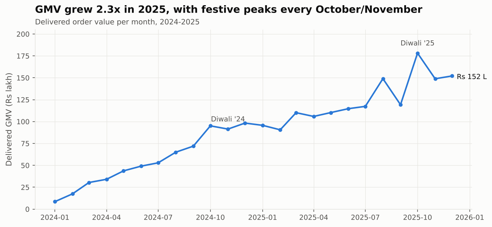
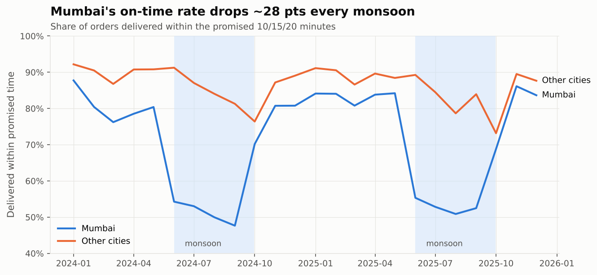
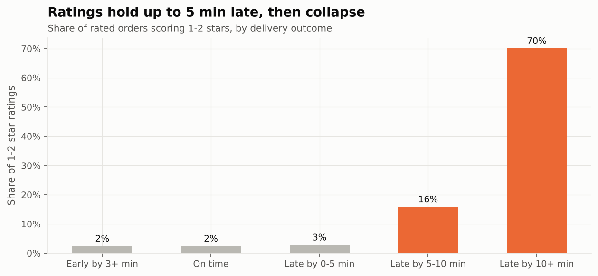
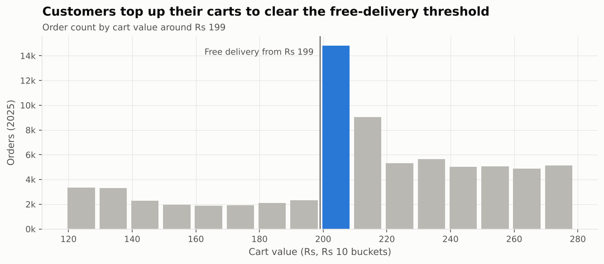
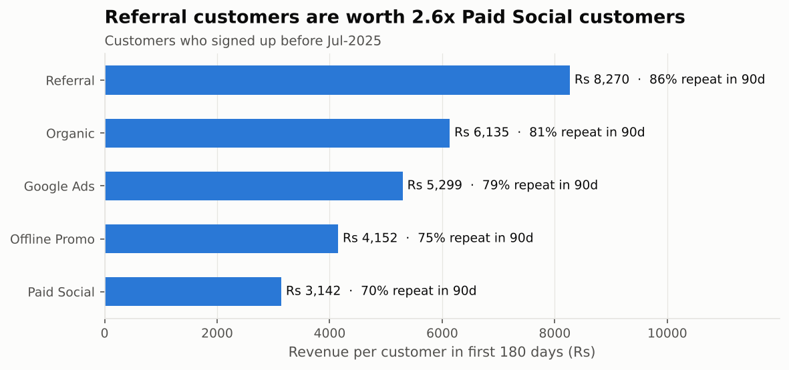
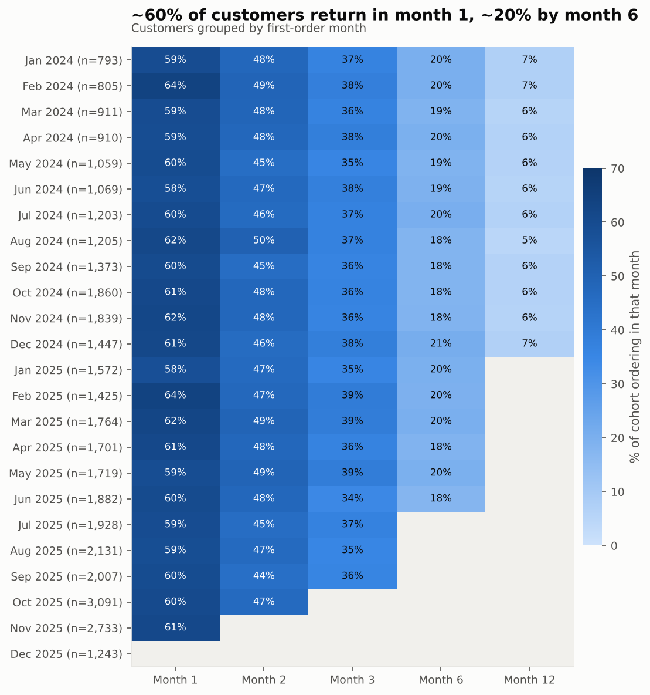

# Quick-Commerce SQL Analytics: 25 Business Questions in SQL

  

An end-to-end SQL case study on a **10-minute grocery delivery business** operating in 8 Indian cities
(Mumbai, Delhi NCR, Bengaluru, Hyderabad, Pune, Chennai, Kolkata, Ahmedabad). It covers 2 years of data:
**451K orders, 1.9M order lines, 38K customers and 38 dark stores**.

The project answers the questions a category manager, city ops lead or growth team would ask. That covers growth,
delivery SLAs, cohort retention, RFM, basket analysis, unit economics and festive-season planning.
All 25 queries are written in **portable SQL**. Each one is verified to return the same results on **PostgreSQL 16**
and **DuckDB**.

> **Data note:** the dataset is synthetic. It is generated by [`src/generate_data.py`](src/generate_data.py) with a fixed
> seed and contains no real customer data. Realistic Indian quick-commerce patterns are built in, such as Diwali/Holi
> spikes, the Mumbai monsoon, IPL-evening snacking and free-delivery threshold behaviour. The SQL has to *discover*
> these patterns from raw tables.

---

## Key findings

| # | Finding | Evidence | Recommendation |
|---|---------|----------|----------------|
| 1 | **GMV grew 2.3x in 2025** (Rs 6.6 Cr → Rs 14.9 Cr). Diwali week ran **+74% orders/day** at a **54% higher AOV**. | Q01, Q06 | Plan dark-store inventory and rider capacity 2 weeks ahead of Diwali; festive AOV makes it the highest-margin week of the year. |
| 2 | **Mumbai's on-time rate falls from 81% to 52% in the monsoon** (Jun–Sep), and rider-unavailable cancellations rise 2.5x. Other cities barely move. | Q07, Q09 | Monsoon-specific promise times for Mumbai (honest ETAs beat broken promises) and a rain-surge rider incentive. |
| 3 | **A late first delivery costs the customer relationship.** Customers whose first order arrived >4 min late placed **21% fewer orders** in the next 90 days (5.35 vs 6.78). | Q11, Q25 | Route first-time customers' orders to the most reliable riders and stores; add a "first order on time" KPI. |
| 4 | **Ratings collapse after 5 minutes late.** 1-2★ share goes from 3% (late by under 5 min) to **16% (5–10 min)** and **70% (10+ min)**. | Q25 | Set the SLA alert at +5 min, not at the promise time. |
| 5 | **Two dark stores are structural outliers**: Andheri West (Mumbai) and Whitefield (Bengaluru) run 3.5–3.7 min slower than their city's median store, with only 35–38% on-time. | Q08 | Ops audit: picking layout, rider pool size, catchment radius. |
| 6 | **Referral customers are worth 2.6x Paid Social customers** in their first 180 days (Rs 8,270 vs Rs 3,142), with 86% vs 70% 90-day repeat. | Q15 | Shift acquisition budget from Paid Social toward referral rewards. |
| 7 | **The Rs 199 free-delivery threshold works.** There are **6.4x more carts at Rs 199–208 than at Rs 189–198**, because customers top up to avoid the fee. | Q21 | Test a Rs 249 threshold in one city; there is clear willingness to add items. |
| 8 | **Champions (19% of customers) generate 45% of revenue.** 6,000 top-quartile customers have lapsed 45+ days (**Rs 9.7 Cr lifetime spend**). | Q14, Q19 | Win-back campaign on the Q19 list, prioritising Bengaluru/Mumbai/Delhi. |
| 9 | **Coupons cut per-order contribution by ~40%** (Rs 62 vs Rs 104) without raising cart value (Rs 500 vs Rs 494). | Q22 | Restrict SAVE10 to lapsed/at-risk segments instead of blanket use. |
| 10 | Bengaluru and Mumbai earn **Rs 70+ contribution per order** vs **Rs 51 in Ahmedabad**, driven by basket size, not delivery cost. | Q24 | Grow basket size in Tier 2 (bundles, staples) before adding stores. |

<p align="center">
  
  
</p>
<p align="center">
  
  
</p>
<p align="center">
  
  
</p>

---

## The 25 questions

Every file in [`sql/analysis/`](sql/analysis) starts with the business question and the SQL skills it demonstrates.
All outputs are in [`results/RESULTS.md`](results/RESULTS.md).

| Area | Query | SQL techniques |
|------|-------|----------------|
| **Growth** | [01 Monthly KPIs, MoM & YoY](sql/analysis/01_monthly_kpis.sql) | `LAG()`, named `WINDOW`, `FILTER` |
| | [02 City scorecard](sql/analysis/02_city_scorecard.sql) | `RANK()`, `SUM() OVER ()` share-of-total |
| | [03 Category margin & penetration](sql/analysis/03_category_margin.sql) | ratio-of-sums, `COUNT(DISTINCT)` |
| | [04 Pareto: SKUs driving 80% revenue](sql/analysis/04_pareto_skus.sql) | running total with window frame |
| | [05 Hour x weekday heatmap](sql/analysis/05_hourly_heatmap.sql) | pivot with `COUNT(*) FILTER` |
| | [06 Festive uplift (Diwali, Holi…)](sql/analysis/06_festive_uplift.sql) | `VALUES` CTE, range join, baseline |
| **Operations** | [07 On-time % by city & month](sql/analysis/07_sla_by_city_month.sql) | conditional averages, pivot |
| | [08 Outlier dark stores](sql/analysis/08_worst_stores.sql) | `PERCENTILE_CONT`, `RANK() OVER (PARTITION BY)` |
| | [09 Mumbai monsoon impact](sql/analysis/09_monsoon_impact.sql) | derived dimensions, `LEFT JOIN` |
| | [10 Cancellations by reason & time](sql/analysis/10_cancellations.sql) | `CASE` bucketing |
| | [11 First-order experience → retention](sql/analysis/11_first_order_experience.sql) | `ROW_NUMBER()`, interval windows |
| | [12 New-store ramp-up curve](sql/analysis/12_new_store_rampup.sql) | date arithmetic, week bucketing |
| **Customers** | [13 Monthly cohort retention](sql/analysis/13_cohort_retention.sql) | cohort analysis, `MIN() OVER` |
| | [14 RFM segmentation](sql/analysis/14_rfm_segments.sql) | `NTILE(5)`, rule-based segments |
| | [15 Acquisition-channel quality](sql/analysis/15_channel_quality.sql) | time-bounded `LEFT JOIN` aggregates |
| | [16 Time to second order](sql/analysis/16_time_to_second_order.sql) | `LEAD()`, cumulative distribution |
| | [17 Top 3 customers per city](sql/analysis/17_top_customers_per_city.sql) | top-N per group |
| | [18 Weekly ordering streaks](sql/analysis/18_ordering_streaks.sql) | **gaps & islands** |
| | [19 High-value win-back list](sql/analysis/19_winback_list.sql) | quartiles, actionable list |
| **Basket & pricing** | [20 Frequently bought together](sql/analysis/20_market_basket.sql) | self-join, support / confidence / lift |
| | [21 Free-delivery threshold bunching](sql/analysis/21_free_delivery_threshold.sql) | histogram bucketing |
| | [22 Coupon effectiveness](sql/analysis/22_coupon_effectiveness.sql) | `COALESCE`, contribution margin |
| | [23 Festive daily tracker](sql/analysis/23_daily_running_totals.sql) | 7-day moving average, MTD running total |
| | [24 Unit economics by city](sql/analysis/24_unit_economics.sql) | parameter CTE for assumptions |
| | [25 What drives ratings](sql/analysis/25_rating_drivers.sql) | conditional share |

### Example: gaps and islands (Q18)

```sql
WITH weeks AS (
    SELECT DISTINCT customer_id,
           FLOOR((order_ts::date - DATE '2024-01-01') / 7.0) AS week_idx
    FROM orders WHERE order_status = 'Delivered'
),
islands AS (   -- consecutive weeks share the same (week_idx - row_number)
    SELECT customer_id,
           week_idx - ROW_NUMBER() OVER (PARTITION BY customer_id ORDER BY week_idx) AS island_id
    FROM weeks
)
SELECT customer_id, island_id, COUNT(*) AS streak_weeks
FROM islands GROUP BY customer_id, island_id;
```

---

## Data model

```
cities ──< dark_stores ──< orders >── customers
                             │  └──< order_items >── products
                             └── deliveries (1 : 0..1, delivered orders only)
```

| Table | Rows | Grain |
|-------|-----:|-------|
| `cities` | 8 | city |
| `dark_stores` | 38 | store (incl. 9 launched during 2024–25) |
| `customers` | 38,000 | customer, with signup date and acquisition channel |
| `products` | 113 | SKU with MRP, selling price, unit cost, private-label flag |
| `orders` | 451,005 | order (Delivered / Cancelled + reason), coupon, fees |
| `order_items` | 1,883,080 | product within an order |
| `deliveries` | 433,432 | promised vs actual minutes, distance, rider, rating |

DDL: [`sql/00_schema.sql`](sql/00_schema.sql). Data-quality rules: [`sql/01_data_quality_checks.sql`](sql/01_data_quality_checks.sql).
These cover reconciliation of `item_total` to line items, orphan keys, orders before a store's launch date, and more.
The rules run in CI.

## Run it

```bash
pip install -r requirements.txt
python src/generate_data.py --out data/raw   # ~90 s, writes 7 CSVs
python src/run_analysis.py                   # runs all 25 queries on DuckDB, writes results/
python src/make_charts.py                    # README charts
pytest -q                                    # 42 tests: data quality + every query
```

**On PostgreSQL** (the queries are portable):

```bash
createdb quickcommerce
psql -d quickcommerce -f sql/00_schema.sql -f sql/load_postgres.sql
psql -d quickcommerce -f sql/analysis/13_cohort_retention.sql
```

## Portability notes (things I hit while validating on both engines)

- `/` on two integers is **integer division in PostgreSQL but float division in DuckDB**. Use `FLOOR(x / 7.0)` explicitly.
- Ordered-set aggregates (`PERCENTILE_CONT ... WITHIN GROUP`) **cannot be window functions in PostgreSQL**. Aggregate in a CTE and join back instead.
- `NTILE()` / `ROW_NUMBER()` over tied values is engine-dependent. Add a unique tie-breaker (`customer_id`) for reproducible segments.
- PostgreSQL's `COPY` rejects `5.0` for a `SMALLINT` column. Nullable integer columns must be written as integers, not floats.

## Project structure

```
├── sql/
│   ├── 00_schema.sql               PostgreSQL-compatible DDL
│   ├── 01_data_quality_checks.sql  13 DQ rules (all must return 0)
│   ├── load_postgres.sql           \copy loader
│   └── analysis/01..25_*.sql       one business question per file
├── src/
│   ├── generate_data.py            synthetic data generator (seeded)
│   ├── db.py                       DuckDB loader
│   ├── run_analysis.py             runs every query → results/*.csv + RESULTS.md
│   └── make_charts.py
├── results/                        query outputs (CSV + RESULTS.md)
├── images/                         charts used in this README
└── tests/                          pytest: DQ checks, every query, metric sanity
```

---

**Author:** Husein Ghadiali · Data Analyst · [LinkedIn](https://linkedin.com/in/husein-ghadiali) · [GitHub](https://github.com/HuseinGhadiali)
